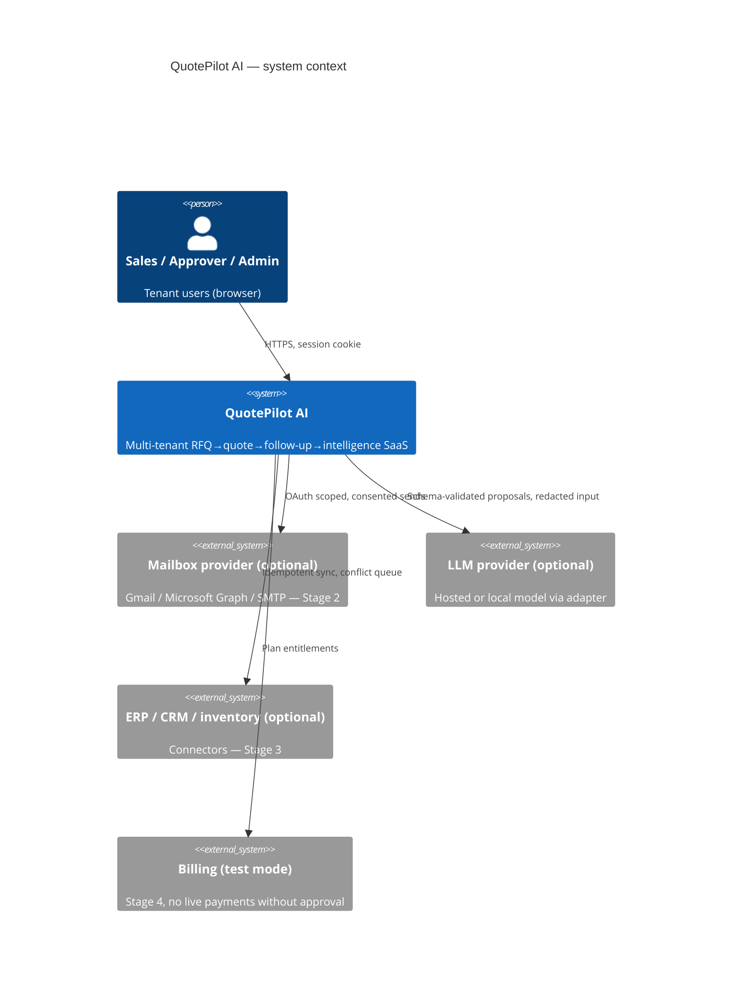
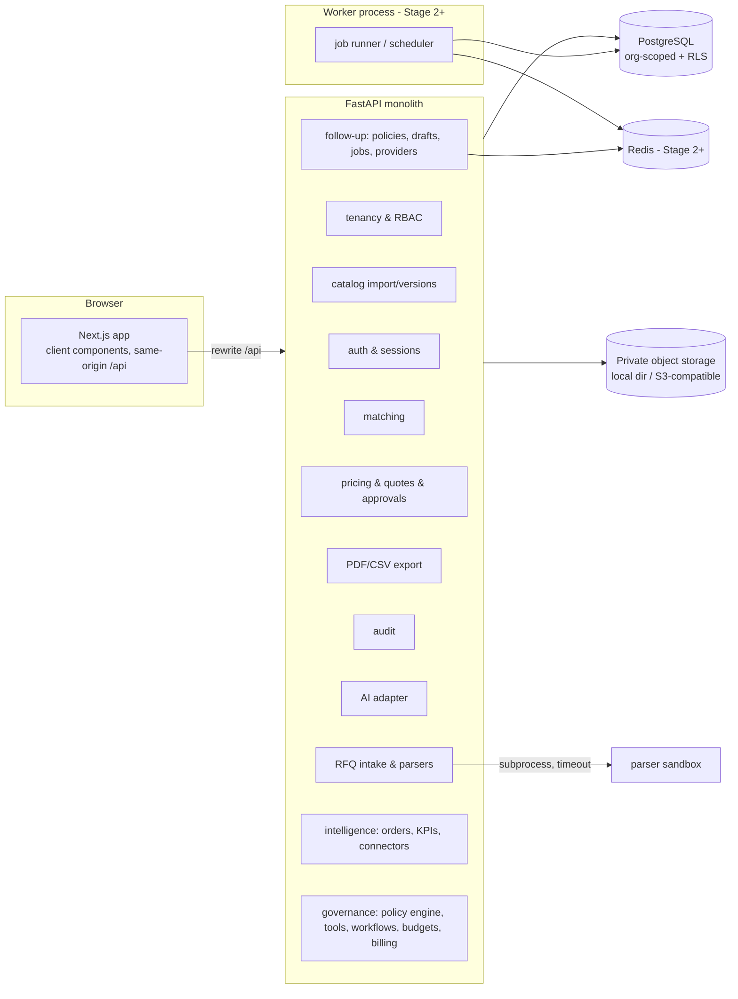
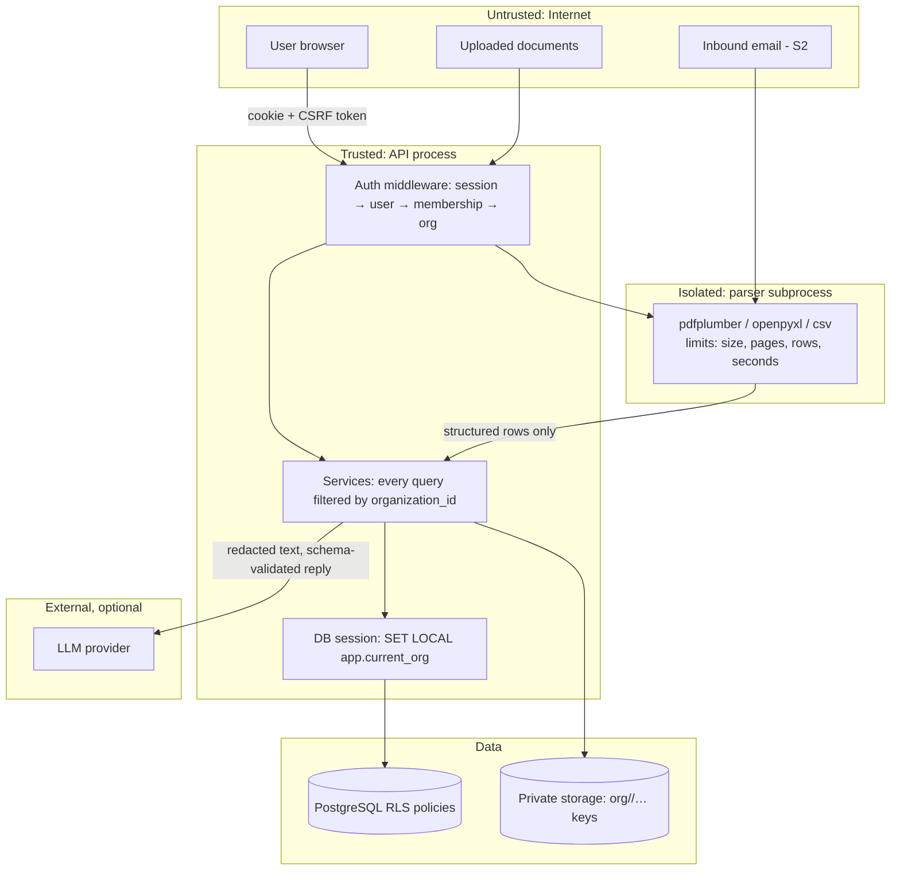
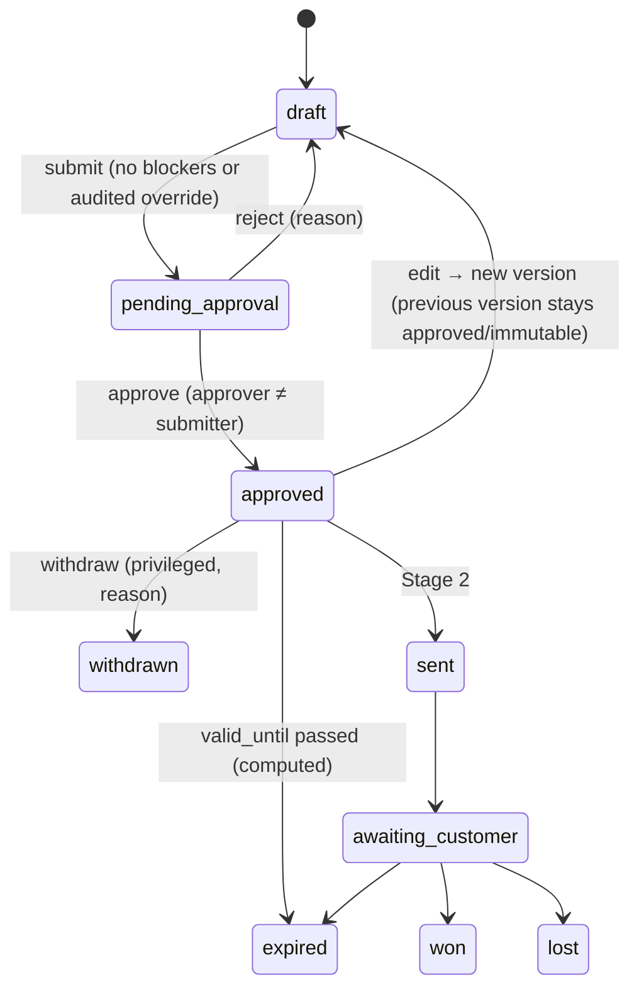
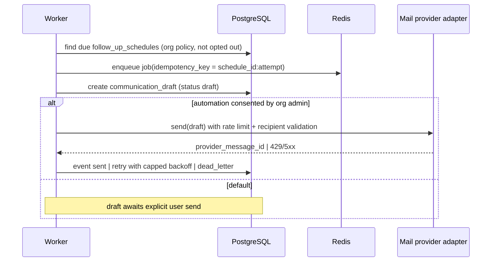
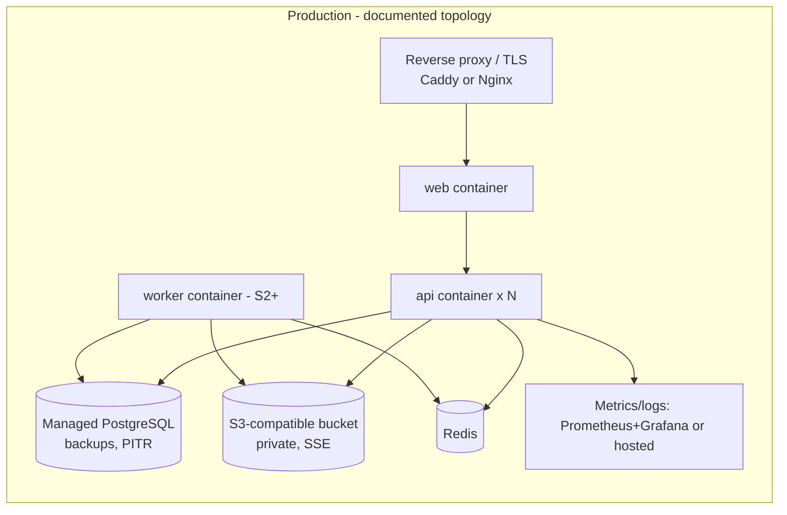

# High-Level Design

## System context


## Modules

Single deployable API (modular monolith) with a separate worker process from Stage 2. No microservices.

## Tenant-aware data flow and trust boundaries

Trust rules: document and email content never becomes code, SQL, template or shell input. LLM output is parsed into
Pydantic models and merged as *proposed* data. Storage keys are server-generated; downloads go through authorized API.

## Auth and approval flow
```mermaid
sequenceDiagram
  participant B as Browser
  participant A as API
  participant DB as PostgreSQL
  B->>A: POST /api/auth/login (email, password)
  A->>DB: load user, verify Argon2id hash
  A->>DB: insert session (hashed token, expiry)
  A-->>B: Set-Cookie qp_session (HttpOnly, SameSite=Lax, Secure*) + csrf cookie
  B->>A: POST /api/quotes/{id}/submit (X-CSRF-Token)
  A->>A: resolve session → user → membership(role) → org
  A->>DB: BEGIN; SET LOCAL app.current_org; update quote; insert audit; COMMIT
  B->>A: POST /api/quotes/{id}/approve (approver account)
  A->>A: role in {owner, admin, approver} AND actor ≠ submitter (unless allowed)
  A->>DB: approval_decision + version.locked + audit
```
`*Secure` flag on when `APP_ENV != development`.

## Quote state machine


## Stage 1 sequence — RFQ to PDF
```mermaid
sequenceDiagram
  participant S as Sales (browser)
  participant A as API
  participant P as Parser subprocess
  participant DB as PostgreSQL
  participant ST as Storage
  S->>A: POST /api/rfqs (multipart file | text)
  A->>A: validate size/type; store original
  A->>ST: put org/<org>/rfq/<id>/original
  A->>P: parse(path, kind) with timeout
  P-->>A: items[{raw_text, qty, unit, sku?, source_ref}] | error
  A->>DB: rfq.status = parsed|failed, rfq_items, match_candidates
  S->>A: PATCH /api/rfqs/{id}/items/{iid} (select candidate / edit)
  S->>A: POST /api/rfqs/{id}/generate-quote
  A->>DB: quote + version 1 + lines (Decimal pricing)
  S->>A: POST /api/quotes/{id}/submit (expected_version)
  Note over A: approver account
  A->>DB: approve → version locked, decision, audit
  S->>A: POST /api/quotes/{id}/versions/{n}/pdf → render deterministic PDF → ST
  S->>A: GET /api/quotes/{id}/versions/{n}/pdf (authorized stream)
```

## Stage 2 sequence — follow-up


## Stage 3 flow — intelligence
Orders are created from approved/won quotes (approval required), connector syncs write to staging tables and a
conflict queue; KPI service computes metrics from recorded events with explicit definitions; exports pass through the
role-aware serializer so cost/margin fields are stripped for Sales/Read-only.

## Stage 4 flow — bounded assistant
```mermaid
sequenceDiagram
  participant U as User
  participant A as API (policy engine)
  participant L as LLM adapter
  participant T as Tool registry
  U->>A: ask("prepare follow-up for Q-1024")
  A->>A: tools = policy.allowed_tools(user.role, plan, org.kill_switch)
  A->>L: prompt(redacted context, tool schemas) within budget
  L-->>A: structured tool call(s)
  A->>A: validate schema + scope; reject unknown/out-of-scope
  A->>T: execute read tool (tenant-scoped query)
  A->>U: proposal with evidence citations
  U->>A: approve action
  A->>T: execute write tool under approval record + audit
```

## Deployment

Local demo: `infra/docker-compose.yml` (postgres, redis, api, web, migrate+seed). See OPERATIONS_RUNBOOK.md.

## Failure modes, timeouts, retries, idempotency (summary; details in LLD)
| Flow | Failure | Handling |
|---|---|---|
| Upload/parse | oversize, bad type, parser crash/timeout | 413/415 before storage; RFQ `failed` with reason; retry endpoint; no partial lines |
| Pricing | missing price, currency mismatch, below margin | blocker list on quote; submit refused; privileged override with reason |
| Concurrency | two editors | `expected_version` → 409 with current version |
| PDF | render error | version stays approved; export retriable; audit `export_failed` |
| Sessions | expiry/revocation | 401 → login; sessions table checked each request |
| Stage 2 jobs | provider 429/5xx/timeout | capped exponential backoff (max 5), idempotency key prevents duplicate send, dead-letter after cap |
| Stage 3 sync | conflict | staging + conflict queue, human resolution |
| Stage 4 agent | loop, oversize, budget | depth/turn caps, token budget, circuit breaker, kill switch |
