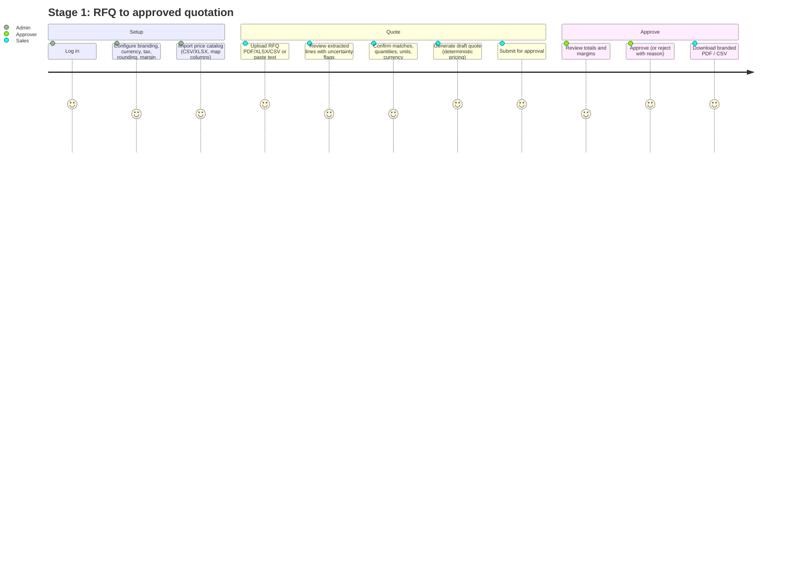

# User Journeys & UX Specification

## Personas
- **Owner (Omar)** — runs a 12-person trading company; approves discounts; wants control and visibility.
- **Sales (Sara)** — handles 15 RFQs/day; wants fast, accurate quotes and reminders.
- **Approver (Ahmed)** — sales manager; checks margin and terms before anything goes out.
- **Admin (Ines)** — maintains price lists, users and branding.
- **Read-only (Finance)** — views quotes and exports for reconciliation; cannot change anything.

## Role permission matrix (server-enforced; see `SECURITY_POLICY.md`)
| Action | Owner | Admin | Sales | Approver | Read-only |
|---|---|---|---|---|---|
| Manage org settings / members | ✔ | ✔ | – | – | – |
| Import catalog | ✔ | ✔ | – | – | – |
| Create/edit RFQ, quote drafts | ✔ | ✔ | ✔ | ✔ | – |
| Submit quote for approval | ✔ | ✔ | ✔ | ✔ | – |
| Approve / reject quote | ✔ | ✔ | – | ✔ | – |
| Privileged override (missing price / below margin) | ✔ | ✔ | – | – | – |
| Withdraw approved quote | ✔ | ✔ | – | ✔ | – |
| Export PDF/CSV | ✔ | ✔ | ✔ | ✔ | ✔ |
| View cost / margin fields | ✔ | ✔ | – | ✔ | – |
Separation of duties: the user who submitted a quote version cannot approve it unless the organization setting
`allow_self_approval` is enabled by an Owner (audited).

## Stage 1 journey — RFQ to approved PDF

### Screens (Stage 1)
| Screen | Purpose | States required |
|---|---|---|
| Login | email + password | loading, invalid credentials (generic message), rate limited, server error |
| Dashboard | recent RFQs/quotes, pending approvals | empty (no catalog → CTA), loading, error |
| Settings › Organization | name, address lines, default currency, tax %, rounding, margin floor, validity days, self-approval | validation errors, saved toast, permission denied |
| Settings › Members | list, invite (local-only), change role | permission denied, last-owner guard |
| Catalog | versions list, import wizard (upload → map columns → validate → activate) | parsing errors per row, unsupported file, oversized, duplicates, activation confirmation |
| Customers | list/create minimal customer | empty, validation |
| RFQ › New | upload or paste; customer select | unsupported type, too large, corrupted, scanned-PDF notice, processing, failed (retry) |
| RFQ › Review | extracted lines table: source text, qty, unit, candidate matches (exact/likely/ambiguous/unmatched), reasons | unmatched blocks generation, unit mismatch flag, duplicate-line flag, negative qty error |
| Quote › Editor | lines (sku, description, qty, unit, unit price, discount %, tax %), totals panel, validity, notes | missing price blocks submit, below-margin warning + override (privileged), version conflict banner (409) |
| Quote › Approval | diff against previous version, totals, margin (role-aware), approve/reject with reason | forbidden (not approver / self-approval), already decided |
| Quote › History | versions, approvals, audit events, download PDF/CSV per approved version | empty |
| Quotes list | search by number/customer/status; filters | empty, loading, error |

Accessibility: semantic landmarks, labelled form controls, focus management on dialogs, keyboard-operable tables,
colour never the only indicator (badges carry text), WCAG AA contrast targets.

## Stage 2 journey — follow-up
Sales marks an approved quote as **sent** (manual) or sends via connected mailbox (explicit click, or consented
automation enabled by an Admin). The assistant recommends follow-up actions with reasons ("approved 5 days ago,
no reply recorded, customer prefers email, next business day in Asia/Dubai"), drafts an editable email with the exact
quote number and validity, and never claims sends/replies that are not recorded. Pending follow-ups are visible and
cancellable; opted-out contacts are excluded. Timeline shows recorded events only.

## Stage 3 journey — customer & order intelligence
Owner opens the dashboard: quote volume, conversion, pending value, processing time, repeat orders — each metric with
its definition and date range. Sales opens a customer profile: contacts, preferences, quote history, orders, suggested
repeat order (from history only; approval required to create an order). Admin runs CSV import/export or configures a
connector with explicit permission scopes; conflicts land in a review queue, never silently overwritten.

## Stage 4 journey — governed command center
Unified queue of RFQs, approvals, drafts and order preparation. A bounded assistant answers questions only from
tenant-authorized records with cited evidence, proposes next actions and can invoke narrowly scoped tools; sensitive
actions always stop at an approval checkpoint. Admin configures versioned workflows with dry-run, sees history and
failure explanations, and can hit the kill switch. Plan limits, onboarding, demo workspace and help pages complete
the commercial experience.
